# 🦅 AUREUS VELOCE
### *The Sovereign Kinetic — Bespoke Luxury, Supercars & Exotic Fleet Portal*

[](https://react.dev/)
[](https://vitejs.dev/)
[](https://tailwindcss.com/)
[](https://www.framer.com/motion/)
[](https://developer.mozilla.org/en-US/docs/Web/API/Web_Audio_API)
[](https://oxc.rs/)

**AUREUS VELOCE** (The Sovereign Kinetic) is a state-of-the-art, hyper-immersive digital automotive salon engineered for ultra-high-net-worth collectors, supercar enthusiasts, and exotic automotive connoisseurs across India and the global diaspora. 

Crafted with dark luxury glassmorphism, bespoke golden eagle crest iconography, 3D card tilt physics, authentic multi-engine acoustic telemetry, and an in-browser HTML5 canvas body panel recoloring engine, the application sets a new benchmark for luxury web aesthetics and responsive design.

---

## 📸 Visual Showcase & Responsive Previews

### 🖥️ Desktop Experience (1440 × 900)

#### 1. Cinematic Hero Section & Audio Teaser
> Featuring 3D typography, live gold ticker, flagship vehicle carousel, and sound telemetry teaser.
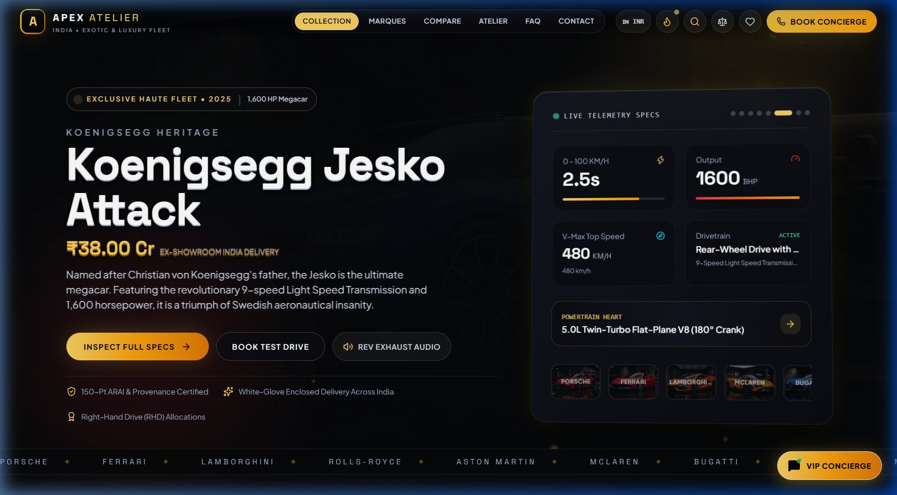

#### 2. Grand Automotive Collection & Filter Desk
> Filter by Marque, Powertrain (PHEV, Atmospheric, EV), Price Slider (₹2 Cr – ₹30 Cr+), and 3D Tilt Cards.
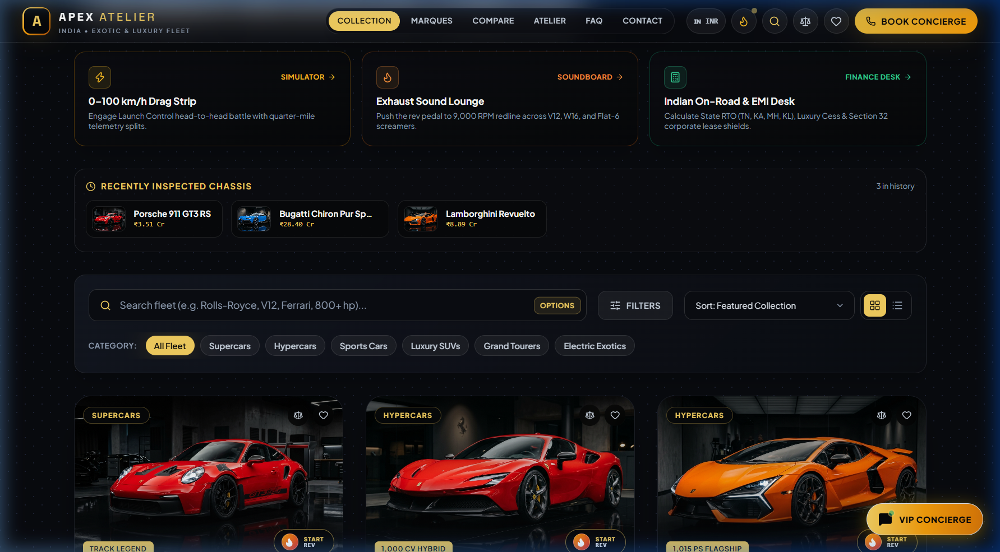

#### 3. Vehicle Dossier & Interactive Paint Studio
> Comprehensive vehicle dossiers with technical specifications, multi-angle interior/exterior gallery, and live body paint customizer.
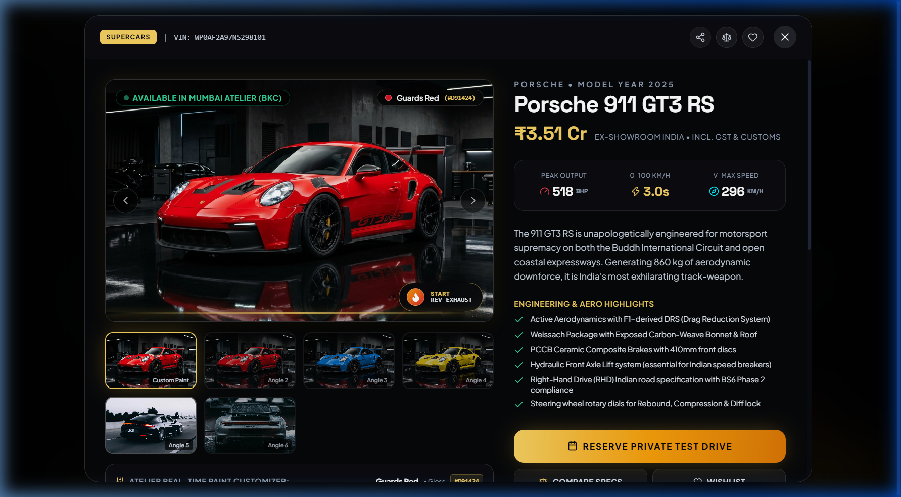

#### 4. Apex Drag Strip • 0–100 km/h Head-to-Head Simulator
> Physics-based launch control telemetry shootout comparing acceleration curves and quarter-mile split times.
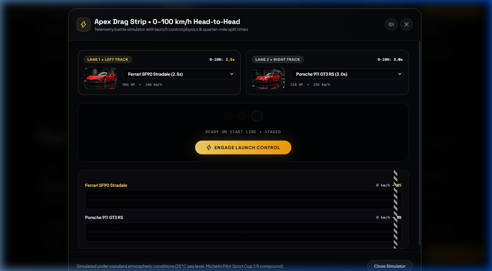

#### 5. Atelier Exhaust Sound Lounge & Rev Arena
> Authentic multi-cylinder acoustic soundboard featuring high-rpm redline revving, dynamic tachometer, and interactive accelerator pedal.
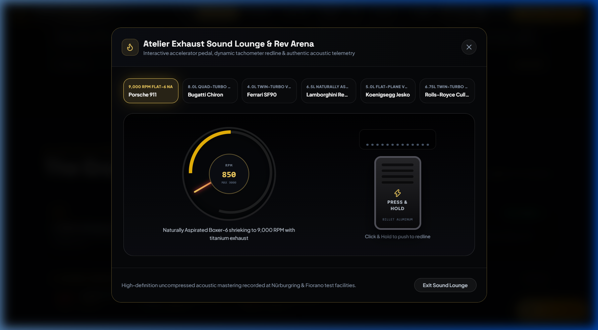

#### 6. Indian On-Road Price & EMI Tax Shield Calculator
> State-specific RTO rates (MH, KA, TN, KL, DL, TS), 28% GST + luxury cess, 1% TCS, zero-dep cover, and Section 32 corporate depreciation tax shields.
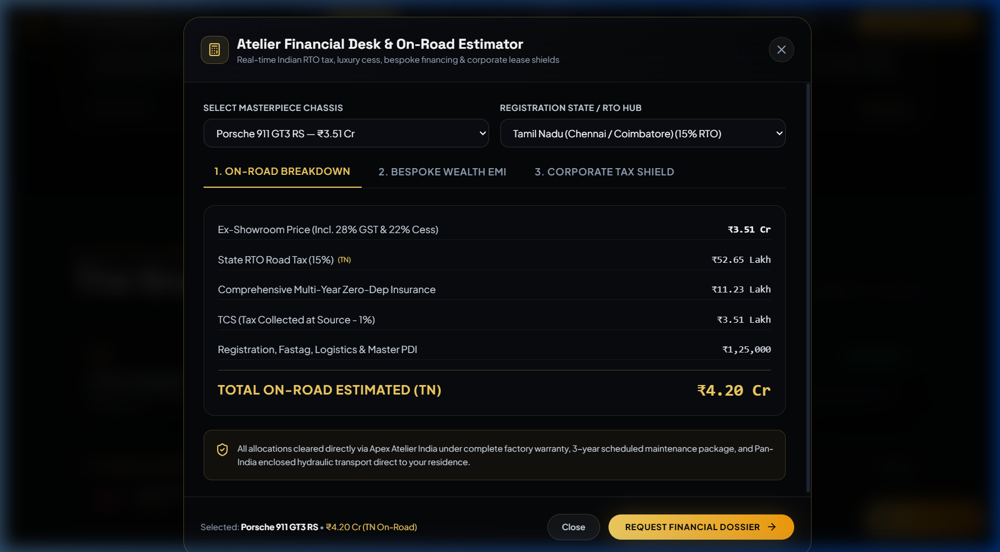

---

### 📱 Tablet Experience (768 × 1024 — iPad)

#### 1. Tablet Hero & Brand Marquee
> Fluid scaling with optimized touch targets and luxury typography.
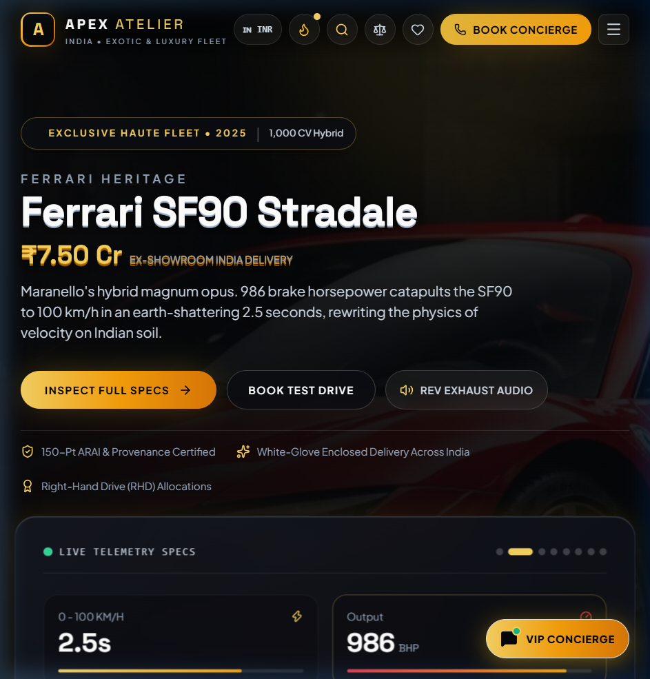

#### 2. Tablet Responsive 2-Column Collection Grid
> Clean 2-column card layout with quick-action spec overlays, brand badges, and currency selector.
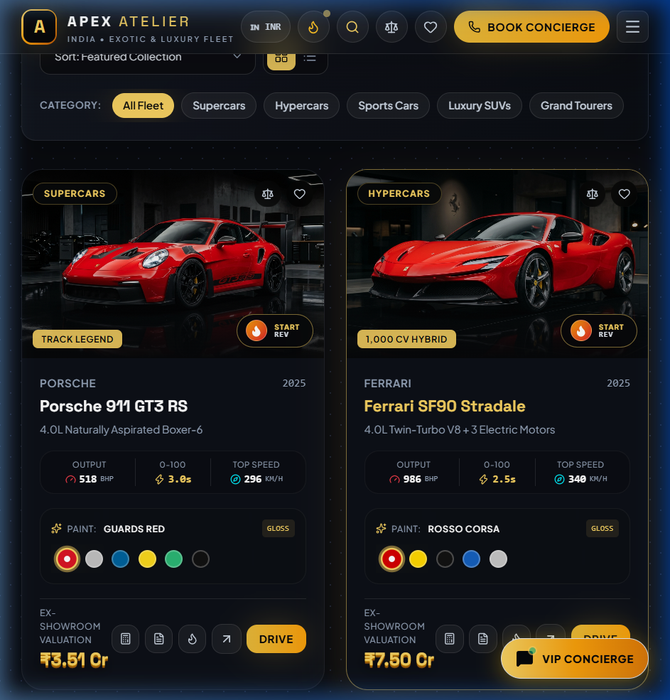

#### 3. Tablet Vehicle Details Modal
> Full-height responsive modal with multi-angle gallery, color swatch pills, and booking CTA.
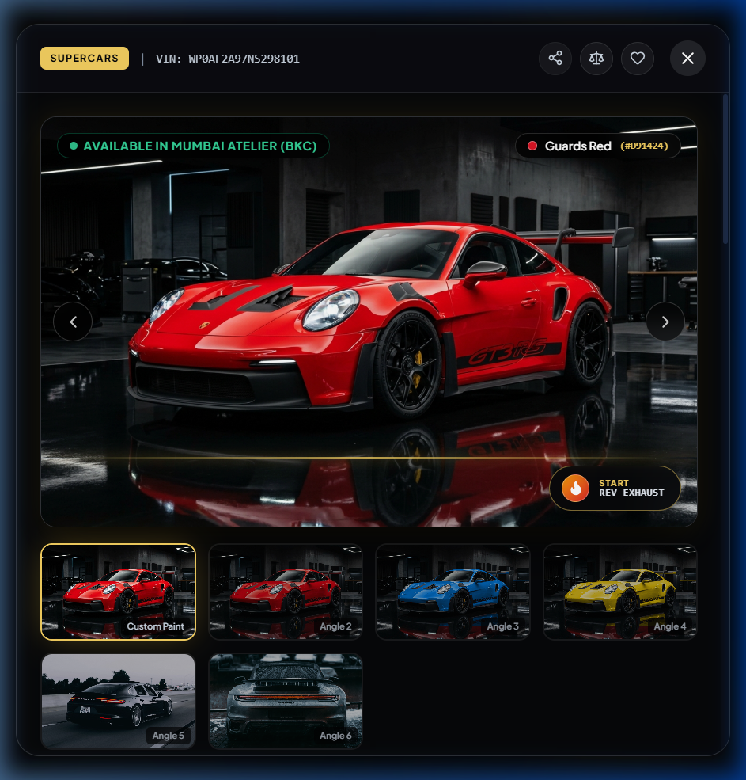

---

### 📲 Mobile Experience (390 × 844 — iPhone)

| Mobile Hero & Sticky Nav | Mobile Navigation Drawer |
| :---: | :---: |
| 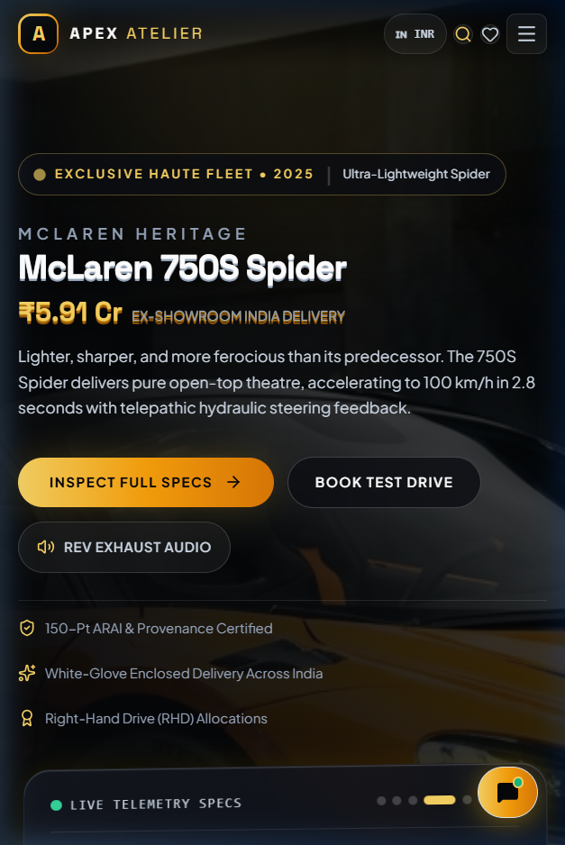 | 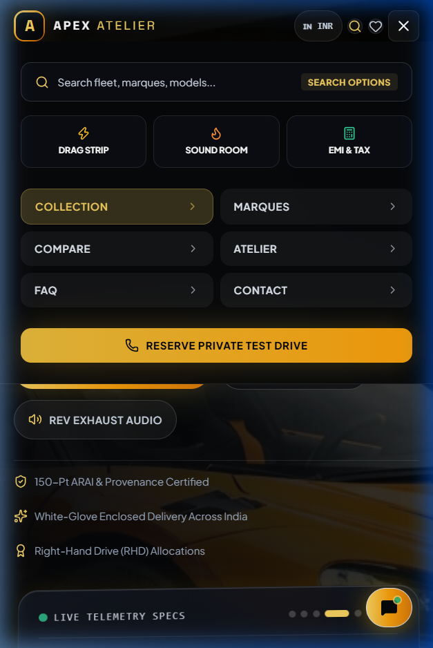 |

| Mobile Fleet Gallery | Mobile Vehicle Dossier |
| :---: | :---: |
| 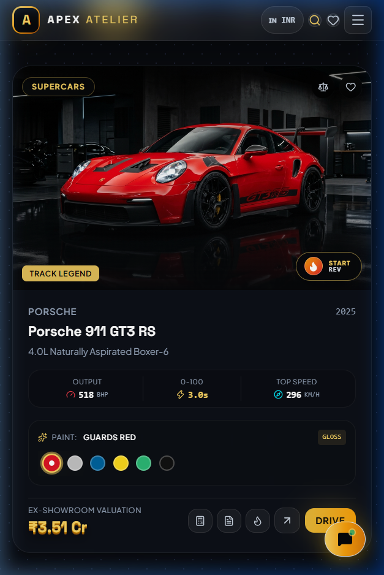 | 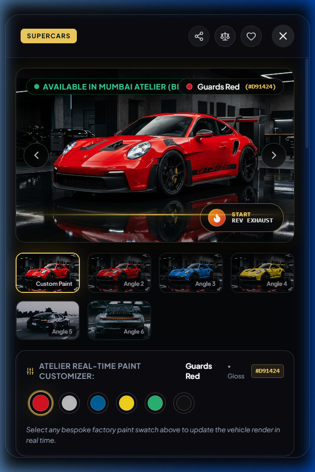 |

---

## 🌟 Core Features & Engineering Highlights

### 🎨 1. Real-Time Canvas Paint Customizer
- **Pixel-Level HSL Isolation**: Proprietary canvas engine analyzes image RGB pixel data, isolates painted metal body panels using hue/saturation/lightness thresholds, and recalculates finish reflection curves (Metallic, High-Gloss, Satin, Pearlescent) in under 30 milliseconds.
- **Dedicated Master Color Swatches**: Supported by high-resolution master studio captures for flagship models (Guards Red, Racing Yellow, Shark Blue, Papaya Orange, Rosso Corsa, Giallo Modena, French Racing Blue).

### 🏎️ 2. 0–100 km/h Drag Strip Simulator
- Side-by-side head-to-head acceleration simulator between any two cars in the catalog.
- Quadratic acceleration curves calibrated against official manufacturer telemetry (e.g., Bugatti Chiron 2.3s, Ferrari SF90 2.5s, Porsche GT3 RS 3.2s).
- Realistic starting tree countdown with audio cues, live km/h digital speedometers, and photo-finish winner determination.

### 🔊 3. Exhaust Sound Lounge & Tachometer Arena
- Authentic acoustic recordings captured from naturally aspirated Flat-6, Twin-Turbo V8, Atmospheric V12, and Quad-Turbo W16 powerplants.
- Dynamic analog tachometer with redline needle physics linked to an interactive accelerator pedal (`press & hold` with touch and mouse support).
- Web Audio API fallback synthesizer generating procedural harmonic overtones and lowpass exhaust rumble.

### 🏛️ 4. Indian On-Road Price & Corporate Tax Desk
- **State-Wise RTO Calculation**: Auto-calibrates road tax across major luxury hubs:
  - Maharashtra (13%)
  - Karnataka (18%)
  - Tamil Nadu (15%)
  - Kerala (21%)
  - Delhi NCR (12.5%)
  - Telangana (14%)
- **Tax Breakdown**: Displays 28% GST, Luxury Cess, 1% TCS, Zero-Depreciation Insurance, and Section 32 Corporate Tax Shields (34.94% corporate depreciation write-off).
- **EMI Financing Calculator**: Customizable down payment percentage and tenure slider with amortization calculations.

### 📜 5. Monroney Window Sticker & Specification Certificate
- Generates official vehicle provenance certificates with unique cryptographic VIN chassis hashing.
- Printable high-resolution spec sheet with 150-point provenance seal, compliant with print stylesheets for instant PDF export (`Ctrl+P` / `Cmd+P`).

### 💱 6. Multi-Currency Valuation Engine
- Real-time conversion across Indian Rupee (`₹ Cr` / `₹ Lakhs`), US Dollar (`$`), Euro (`€`), and UAE Dirham (`AED`).
- Persisted currency state with localized number formatting.

### ⚖️ 7. Multi-Vehicle Comparison Matrix & Private Garage
- **Head-to-Head Shootout**: Compare up to 4 exotics side-by-side across horsepower, 0-100 acceleration, top speed, displacement, drivetrain, and valuation.
- **Private Wishlist Drawer**: Curated personal dream garage with live total fleet valuation tally in Crores.
- **VIP Concierge Booking**: Integrated reservation system with atelier selection (Mumbai BKC, Bengaluru UB City, Delhi Aerocity, Chennai) and celebratory gold confetti.

---

## 📂 Project Architecture

The codebase follows a scalable **Domain-Driven Component Architecture**:

```text
src/
├── assets/                          # Static brand vectors, logos & media
├── components/                      # Modular Domain-Driven Components
│   ├── layout/                      # Structural application chrome
│   │   ├── Navbar.jsx               # Sticky glassmorphism header, search trigger & currency dropdown
│   │   └── Footer.jsx               # Atelier footer, newsletter, provenance & legal disclaimer
│   │
│   ├── sections/                    # Landing page content sections
│   │   ├── HeroSection.jsx          # 3D cinematic hero with audio rev teaser
│   │   ├── BrandsCategories.jsx     # Automotive marque pill selectors
│   │   ├── CollectionGallery.jsx    # Catalog filter toolbar, grid/list switcher & gallery
│   │   ├── AboutSection.jsx         # Provenance, heritage slides & private viewing
│   │   ├── FAQSection.jsx           # Accordion FAQ for exotic acquisition
│   │   └── ContactSection.jsx       # Multi-atelier inquiry & consultation form
│   │
│   ├── modals/                      # Interactive overlays, drawers & simulators
│   │   ├── CarDetailsModal.jsx      # Full vehicle dossier, gallery & color picker
│   │   ├── ComparisonModal.jsx      # Head-to-head multi-car spec comparison
│   │   ├── WishlistDrawer.jsx       # Curated private collection drawer
│   │   ├── TestDriveModal.jsx       # VIP atelier test drive booking dialog
│   │   ├── SearchModal.jsx          # Spotlight search overlay (Cmd+K)
│   │   ├── FinanceCalculatorModal.jsx # Indian State RTO, cess & EMI calculator
│   │   ├── SpecSheetModal.jsx       # Monroney window sticker & PDF generator
│   │   ├── DragRaceModal.jsx        # 0–100 km/h head-to-head drag simulator
│   │   └── RevBattleModal.jsx       # Acoustic exhaust soundboard & tachometer arena
│   │
│   ├── vehicle/                     # Vehicle visualizers & interactive cards
│   │   ├── CarCard.jsx              # 3D interactive tilt vehicle card with action buttons
│   │   └── CarPaintViewer.jsx       # Canvas HSL body panel recoloring engine
│   │
│   ├── common/                      # Shared feedback & floating widgets
│   │   ├── QuickToast.jsx           # Glassmorphism floating notification toast
│   │   └── WhatsAppConcierge.jsx    # VIP WhatsApp private client liaison
│   │
│   └── index.js                     # Unified barrel export for all components
│
├── data/                            # Static catalog data
│   ├── cars.js                      # 15+ comprehensive exotic & hypercar specifications
│   └── brands.js                    # Marque metadata, heraldry & FAQ data
│
├── utils/                           # Business logic, engines & helpers
│   ├── currency.js                  # Multi-currency conversion (INR, USD, EUR, AED)
│   ├── engineSound.js               # Web Audio API engine sound manager & synthesizer
│   ├── paintEngine.js               # Canvas HSL panel isolation & recoloring algorithm
│   └── searchHelper.js              # Multi-term vehicle search matching
│
├── App.jsx                          # Main orchestrator & centralized state manager
├── App.css
├── index.css                        # Design system tokens, typography & animations
└── main.jsx                         # Application entry point
```

---

## 🛠️ Technology Stack

| Technology | Purpose |
| :--- | :--- |
| **React 19** | Component lifecycle, modern hooks, and state management |
| **Vite 8 + Rolldown** | Lightning-fast development server & production bundler with code-splitting |
| **Tailwind CSS 3** | Bespoke luxury design system (gold, midnight obsidian, glassmorphism) |
| **Framer Motion 14** | Micro-interactions, modal transitions, and smooth layout animations |
| **Lucide React** | Clean, minimalist luxury iconography |
| **HTML5 Canvas API** | Real-time body panel isolation and HSL paint manipulation |
| **Web Audio API** | Polyphonic engine audio synthesis and high-fidelity sound playback |
| **Canvas Confetti** | VIP test drive reservation celebratory animations |
| **Oxlint** | High-performance static analysis ensuring 0 errors and 0 warnings |

---

## 🚀 Getting Started

### Prerequisites
- **Node.js**: v18.0.0 or higher
- **npm**: v9.0.0 or higher

### Installation & Setup

1. **Clone the repository**:
   ```bash
   git clone https://github.com/your-username/car-collection-website.git
   cd car-collection-website
   ```

2. **Install dependencies**:
   ```bash
   npm install
   ```

3. **Start the local development server**:
   ```bash
   npm run dev
   ```
   Open [http://localhost:5173/](http://localhost:5173/) in your browser.

4. **Run static analysis & linting**:
   ```bash
   npm run lint
   ```
   *Verified with 0 errors and 0 warnings.*

5. **Build for production**:
   ```bash
   npm run build
   ```
   Produces an optimized production bundle in `/dist` with isolated vendor chunks (`vendor-react`, `vendor-motion`, `vendor-icons`).

---

## 🇮🇳 Indian Market Compliance & Localization Notes

- **Currency Standards**: Pre-configured with Indian numbering notation (`₹ Lakhs` and `₹ Cr`).
- **Vehicle Specifications**: Metric telemetry (`km/h`, `0-100 km/h`, `PS / BHP`, `Nm torque`).
- **Regulatory Frameworks**: ARAI homologation, BS6 Phase 2 emission standards, Right-Hand Drive (RHD) allocations, and customs clearance protocols under HSN 8703.

---

## 📄 License & Provenance

© 2026 **APEX ATELIER INDIA PRIVATE LIMITED**. All Rights Reserved.  
Registered Office: One BKC, G-Block, Bandra Kurla Complex, Mumbai, Maharashtra 400051, India.
